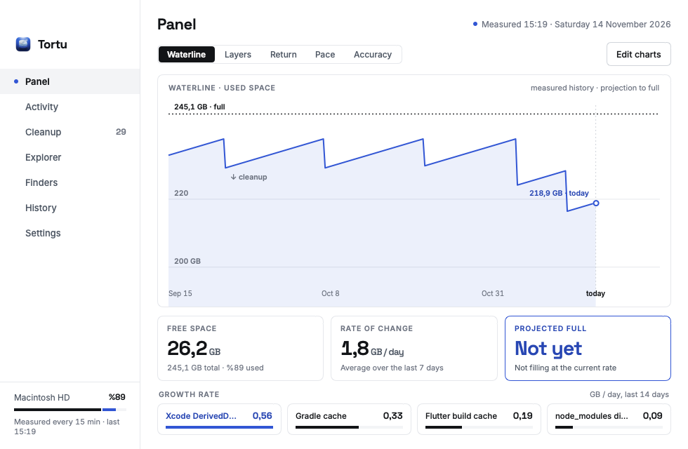
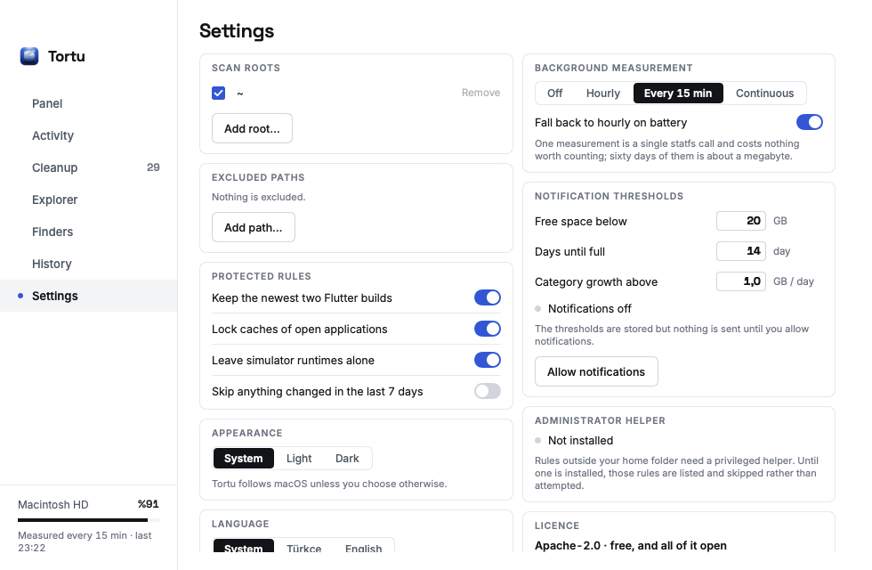
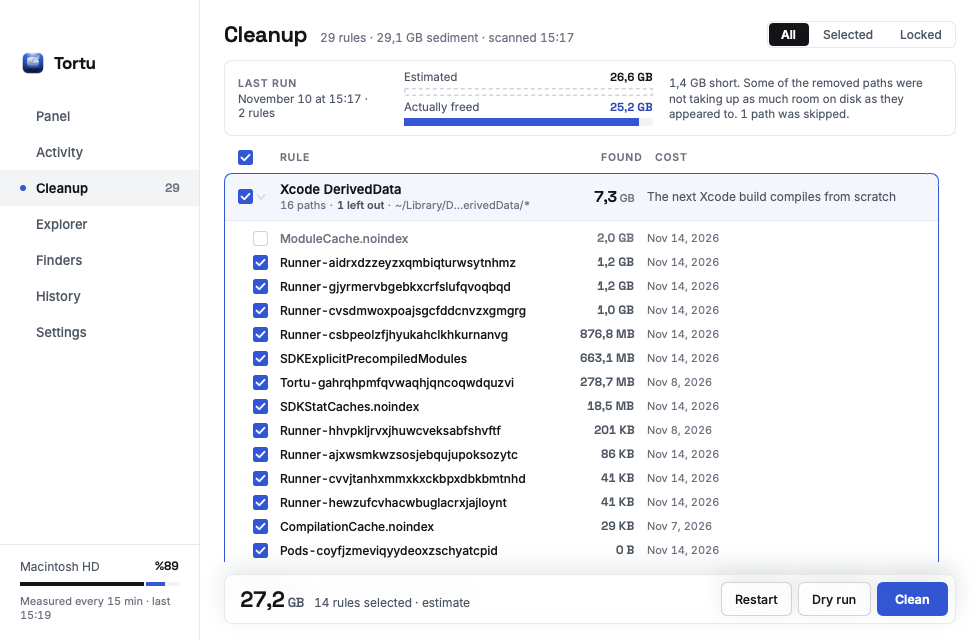
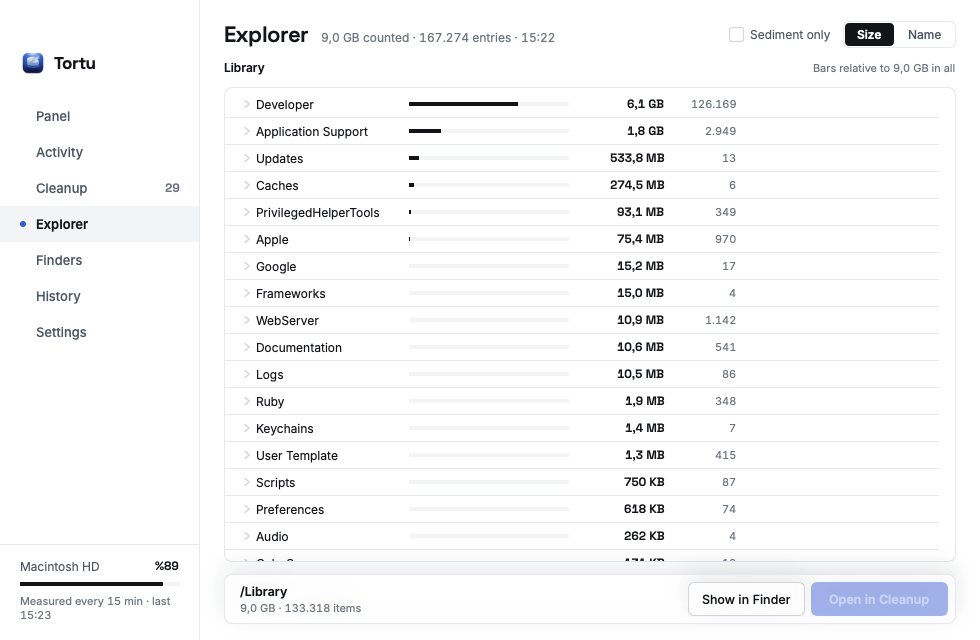
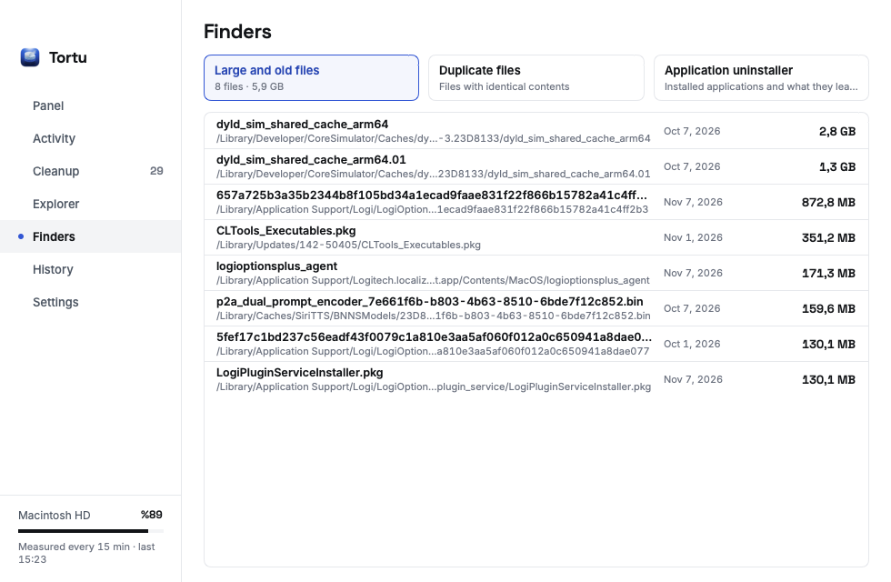
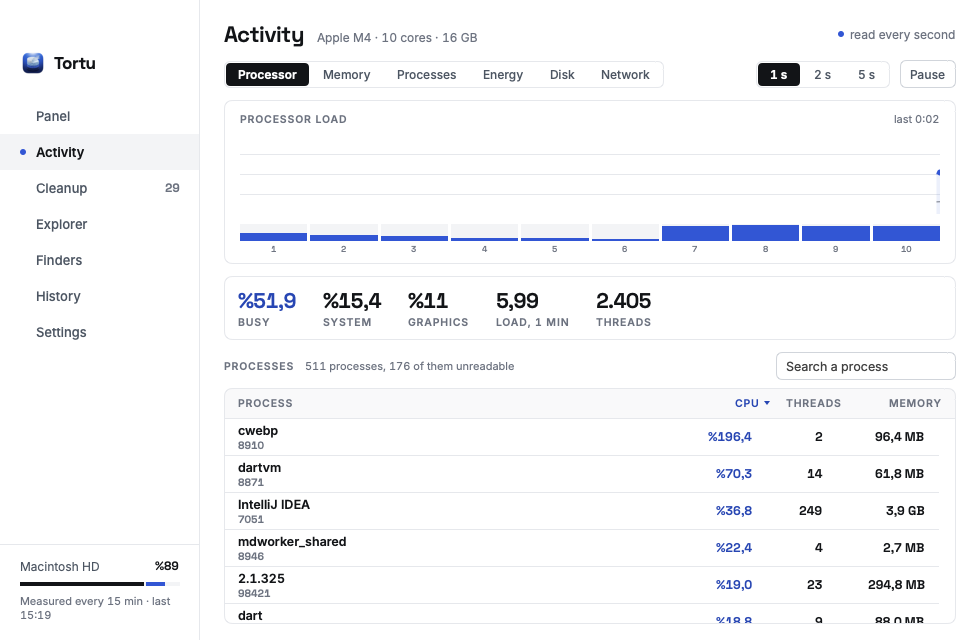
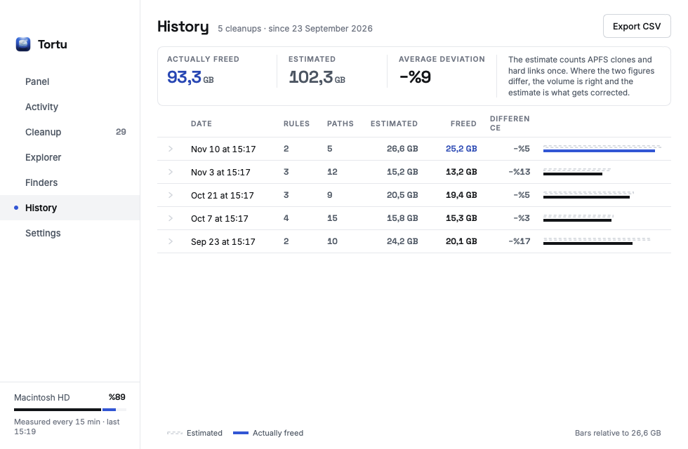
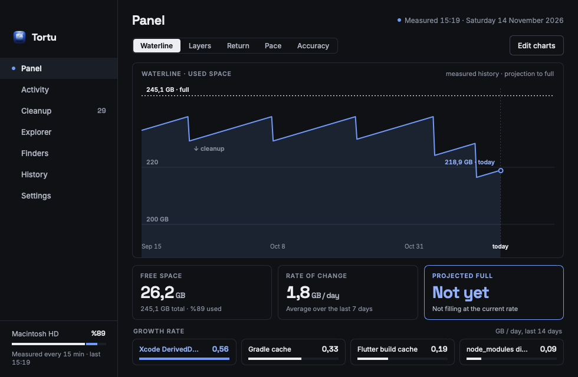

<div align="center">


# Tortu

**A macOS disk tool that finds what quietly accumulates, measures it honestly,
and says how much of it is safe to remove.**

Most disk tools take a snapshot. Tortu keeps a series — so it can tell you not
just what is large, but what keeps coming back.

[](LICENSE)
[](#building)
[](https://swift.org)
[](../../actions/workflows/ci.yml)
[](#testing)

</div>

<br />



<br />

## Why this exists

Tortu grew out of a real problem: a 228 GB development machine that filled up
seven times in two months. Each clean-up returned tens of gigabytes and none of
them lasted. The interesting part was never which files were large — it was how
fast they came back, and which single tool was responsible.

A snapshot cannot answer that. A series can:

> *Xcode's DerivedData went from nothing to 10 GB in eighteen days.*

That is the number that tells you where to look.

## It measures correctly, which is harder than it sounds

- **Walks stop at filesystem boundaries.** `du` once reported 22 GB inside
  `~/Library/Developer/CoreDevice/DeviceFS`. That directory is a `devicefs`
  mount showing a paired iPhone; it occupies 8 KB on the Mac.
- **Boundaries are decided by `st_dev`, not the mount table.** macOS joins the
  System and Data volumes of an APFS volume group with firmlinks and lists both
  as mounts, yet they are one filesystem. Trusting the mount table would skip
  the user's entire home directory.
- **Sizes come from allocated blocks,** because that is what the volume gives
  back. Results are then verified against a real volume reading rather than
  reported from the estimate.

### And the protections are explicit

Four switches decide what no rule may touch — the newest Flutter builds, the
caches of applications that are open, simulator runtimes, anything changed in
the last week. The notification thresholds below them sit next to a plain
statement of whether anything is actually being sent.



## The screens

### Cleanup — a rule is a pattern, so it opens into what it matched

A rule like `~/**/node_modules` matches every project on the machine. Removing
all of them because one line in a catalogue said so is exactly what this
application exists not to do, so every rule opens into the paths it found and
any one of them can be struck out on its own. The footer promises only what is
still ticked.



### Explorer — where the space actually went

A tree of the home folder by allocated size, with the directories a rule
already covers marked, so you can tell "big" from "big and reclaimable".



### Finders — the things rules cannot know about

Files that are merely large, files that exist twice, and applications that are
still installed but have not been opened in months. Everything here goes to the
Trash rather than straight out: unlike a build cache, these are things a person
made.



### Activity — the same approach, pointed at the machine

Processor, memory, processes, energy, disk and network, read as they happen.
Per-core load, the memory split macOS itself reports, every process the kernel
will admit to, where the power is coming from, and traffic per interface.



### History — what each clean-up actually returned

Estimated against measured, every time, so the app's own accuracy is on the
record rather than on trust.



<sub>About these screenshots: Panel and History are filled with seeded sample
data so the charts have something to show. Explorer and Finders were pointed at
`/Library` rather than a home folder — the figures are real, the folder is just
not anybody's. Cleanup and Activity are live readings of the machine they were
captured on.</sub>

## Where it says "I don't know"

The reason to trust a measuring instrument is what it refuses to claim. Tortu
leaves these blank rather than filling them in:

| It could have shown | It shows instead |
| --- | --- |
| A tidy process list | Every process, with **No access** on the ~35% that belong to another user and whose figures an unprivileged app may not read |
| An "energy impact" score | Where the power comes from, and the battery's own volts and amps — Apple's score is a weighting nobody outside Apple can reproduce |
| Network traffic per application | Traffic per interface, because macOS will not tell an unprivileged app which process a packet belonged to |
| Lifetime network totals | Totals it watched accumulate itself — the kernel's byte counters are 32 bits wide and wrap (this machine's loopback had been round six times) |
| A spinner | The figures climbing, the path being read, and how long it has been going |

One more, because it is the kind of mistake that produces a plausible number
rather than an obvious failure: `proc_pidinfo` reports processor time in **mach
absolute units, not nanoseconds**. Reading it as nanoseconds under-reports every
process by about forty times on Apple silicon. A test cross-checks the
conversion against the C library's own figure for the same process.

## Install

No notarised release yet. Build it yourself:

```sh
brew install xcodegen
git clone https://github.com/salih-karagoz/tortu.git
cd tortu
./scripts/install-local.sh
```

That builds Release, replaces `/Applications/Tortu.app` and opens it — but it
signs with a Developer ID certificate, which you will not have. Without one,
build it ad-hoc signed the way CI does:

```sh
xcodegen generate
xcodebuild -project Tortu.xcodeproj -scheme Tortu -configuration Debug \
  CODE_SIGN_IDENTITY="-" CODE_SIGN_STYLE=Manual DEVELOPMENT_TEAM="" \
  OTHER_CODE_SIGN_FLAGS="" build
```

## Building

Requires Xcode 16 or newer and [XcodeGen](https://github.com/yonaskolb/XcodeGen).
The project file is generated and is not checked in.

```sh
xcodegen generate
open Tortu.xcodeproj
```

Tortu is **not sandboxed, by design.** A sandboxed build cannot reach the cache
directories it exists to measure, and cannot install a privileged helper. This
is also why the App Store is not a distribution channel.

## Testing

The logic lives in Swift packages that build and test on their own, with no
signing identity and no Xcode project:

```sh
for package in Packages/*/; do (cd "$package" && swift test); done
```

| Package | Responsibility |
| --- | --- |
| `ScanCore` | Filesystem walking, mount boundaries, size accounting |
| `RulesEngine` | Rule definitions, matching, candidate selection |
| `SafetyKit` | Running-process guards and protected paths |
| `CleanerKit` | Deletion execution and reporting |
| `HelperProtocol` | The XPC contract shared with the privileged helper |
| `HistoryKit` | Samples over time, growth and regrowth analysis |
| `FindersKit` | Large files, duplicates, leftover application support |
| `MonitorKit` | Live processor, memory, process, power, disk and network readings |
| `Entitlements` | The capability gate, kept but not used to withhold anything |

## Rules are data

A cleaner is a JSON file, not Swift code, so a contribution does not require
knowing Swift:

```json
{
  "id": "xcode.derived-data",
  "name": { "en": "Xcode DerivedData", "tr": "Xcode DerivedData" },
  "category": "developer",
  "paths": ["~/Library/Developer/Xcode/DerivedData/*"],
  "strategy": "deleteAll",
  "requiresRoot": false,
  "regrows": true,
  "cost": {
    "en": "The next Xcode build compiles from scratch",
    "tr": "Sonraki Xcode build'i sıfırdan derlenir"
  },
  "blockedByProcesses": ["com.apple.dt.Xcode"]
}
```

`cost` is required: a rule has to say what the user loses, and `regrows`
records that it will come back — which is what the series is for.

See [CONTRIBUTING.md](CONTRIBUTING.md) for what makes a good one.

## Free, and all of it open

There is no paid build, no Pro tier and no licence to buy. Every capability
Tortu has is in the application you download, and all of it is in this
repository under Apache-2.0.

The `Entitlements` package is still here, with its signed-licence verifier and
its tests. It is wired to a provider that unlocks everything, so the gate is one
line rather than an absence — if that ever changes, it changes honestly and in
public, not by quietly locking something that used to work.

Two rules hold whatever happens next. Nothing that scans, deletes or runs as
root will ever be gated: the privileged helper and every rule that removes a
file stay readable by anyone, and a test in the repository fails if a capability
named for scanning, cleaning, deleting or the helper is added to the gated list.
And nothing will be listed as gated that does not have a real gate in the code —
a capability that exists only as a plan does not belong in a type that describes
what the application does.

## Interface

English and Turkish, switchable in Settings. Light and dark, following the
system appearance or pinned to one.

<table>
<tr>
<td width="50%"></td>
<td width="50%"></td>
</tr>
<tr>
<td align="center"><sub>Dark</sub></td>
<td align="center"><sub>Türkçe</sub></td>
</tr>
</table>

Type is Space Grotesk for figures and Inter for text, both bundled under the
SIL Open Font License — see [NOTICE](NOTICE).

## Author

**Muhammed Salih Karagöz** — [muhammedsalihkaragoz.com](https://muhammedsalihkaragoz.com)

## Licence

[Apache License 2.0](LICENSE). See [NOTICE](NOTICE).
